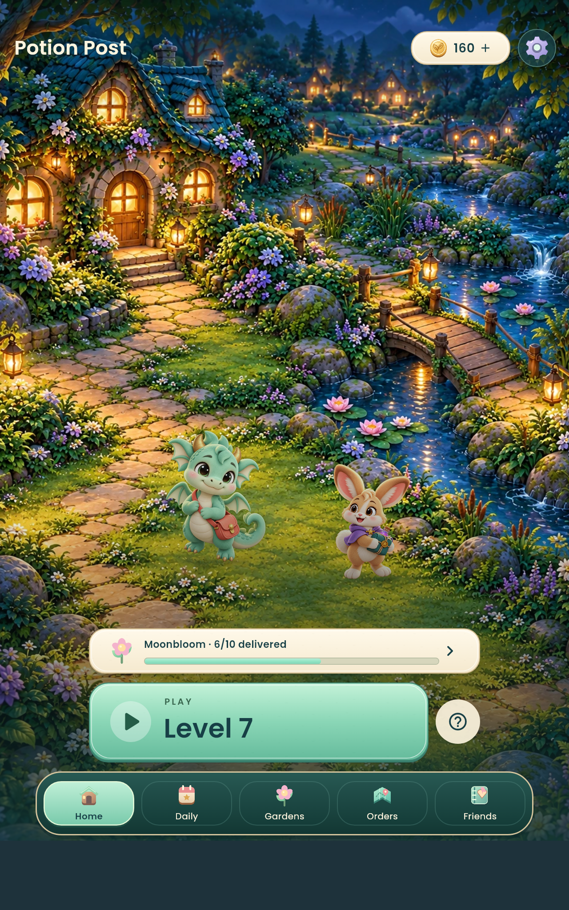
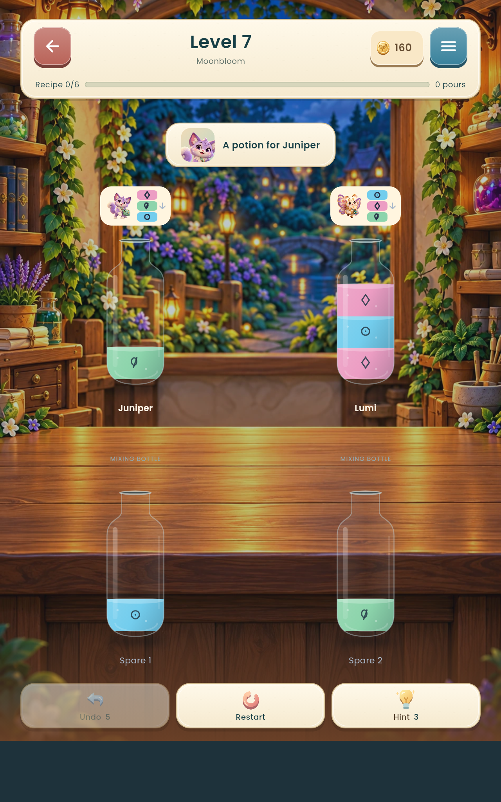
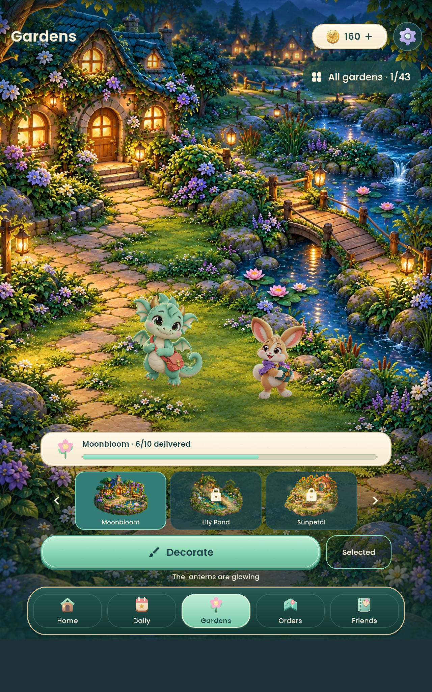
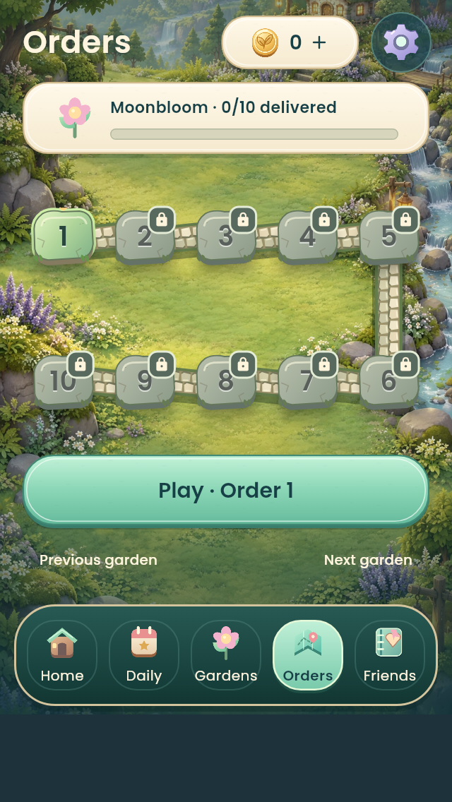
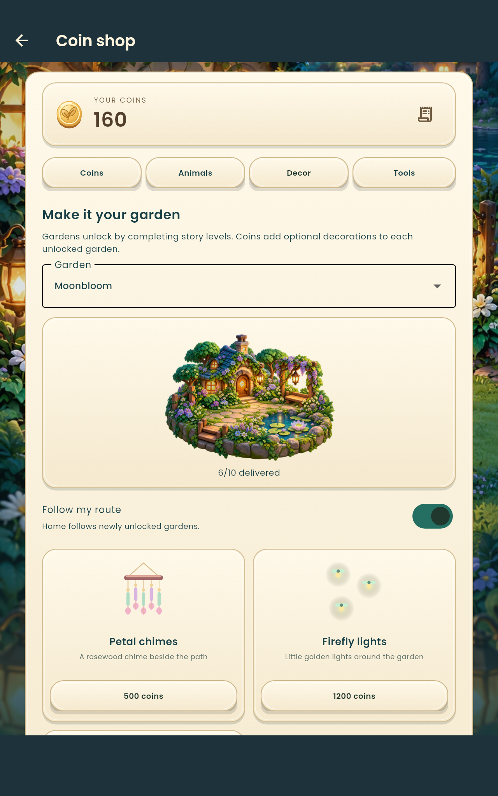
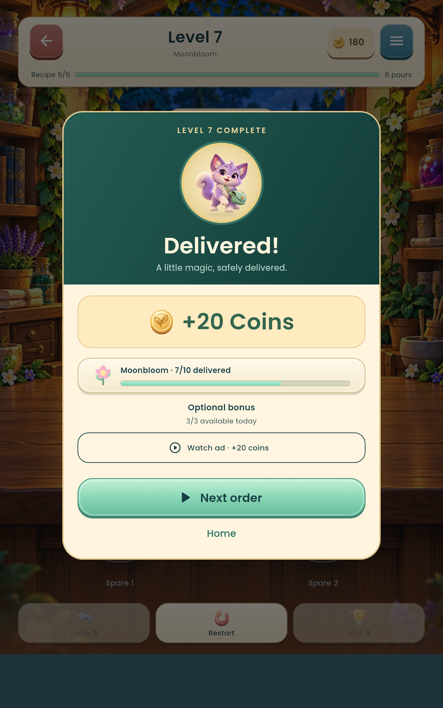

# Potion Post 🧪

**Flutter / Dart · Android casual puzzle game · Personal software project**

Potion Post is a local-first, cozy recipe-and-delivery puzzle game. Players fulfill potion orders, progress through garden routes, collect coins, unlock animal companions, and customize their garden surroundings.

The current archive is **v0.12.0+23**, an actively developed prototype—not a Play Store release. It contains the Flutter application source, game artwork, level data, Android project, and automated tests.

## Gameplay and engineering

- Puzzle controller, order progression, garden unlocks, and local progress persistence.
- In-game currency, earned rewards, cosmetic purchases, and item selection.
- Companion and garden visuals, responsive UI, and animated transitions.
- Google Mobile Ads integration with **demo/test IDs only**. Live publisher setup, privacy/consent work, production signing, and internal device testing remain to be completed.
- Automated regression tests for game logic, economy, saving, selection, layouts, and ad reward behavior.

## Screenshots

| Home | Gameplay | Gardens |
| --- | --- | --- |
|  |  |  |

| Order route | Shop | Delivery |
| --- | --- | --- |
|  |  |  |

> These screenshots are development/host-rendered previews, not proof of a published Android release or live advertising. More background is in [VALIDATION.md](VALIDATION.md).

## Project layout

```text
lib/           App screens, game state, economy, ads, and persistence
assets/        Original UI, characters, environments, and order datasets
test/          Automated Flutter unit and widget tests
android/       Android application project
ios/           iOS project scaffold (not a tested release target)
docs/          Build, integration, and project notes
scripts/       Development / packaging scripts
```

## Setup and testing

This snapshot documents Flutter **3.47.6** and Dart **3.13.5**, with Flutter >=3.41.0 required by `pubspec.yaml`. To run on Android, install a compatible Flutter SDK and Android toolchain:

```bash
flutter pub get
flutter analyze
flutter test
flutter run --flavor standard
```

For other build commands and limitations, see [docs/BUILD.md](docs/BUILD.md).

**Signing:** The original archive included a local ads-test signing key; it is deliberately excluded from this public-source package. Standard debug builds can use a local debug signing identity. A signed adtest/release build requires local signing setup; replacing an old test key does **not** preserve update compatibility with already installed versions. Never commit `.jks`, keystores, credentials, or machine-specific SDK paths.

## Current status

The archived [VALIDATION.md](VALIDATION.md) records **83 passing tests** and clean Flutter analysis at the time it was produced. Those results are project documentation and have **not been independently rerun** while preparing this public-source package. The application is still a prototype; ads use demo IDs and payments/Play Billing are not enabled.

## AI-assisted development

This repository can be worked on with Claude Code or another AI coding assistant. The [CLAUDE.md](CLAUDE.md) file provides repo-specific instructions for code review and development. Verify proposed changes with tests, inspect generated diffs, and commit working increments. AI assistance does not replace manual validation.

## Ownership

Personal project; source and artwork retained for the owner's development and evaluation. No third-party redistribution license is granted by default. Bundled fonts retain their own license under `assets/fonts/OFL.txt`.
